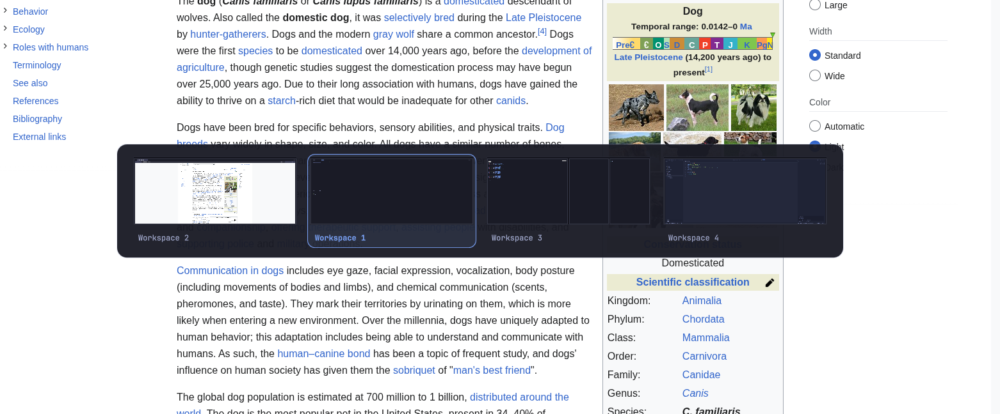

# Omarchy Workspace Switcher

Workspace Switcher lets you move between your recently used workspaces in
Omarchy. Hold Alt and press Tab to open a small strip of workspace previews
in the centre of the focused monitor. Keep pressing Tab to move through them,
then release Alt to switch to the highlighted workspace.



Each preview uses images of the workspace's windows and the layout reported by
Hyprland. This includes tiled and floating windows. Windows that extend beyond
the screen, such as those in a scrolling layout, are clipped at the preview's
edge. Previews keep the screen's proportions and use colours from your Omarchy
theme. They are captured when needed rather than streamed in the background.

The strip adapts to the monitor's size and scrolls to keep the selected
workspace in view. It opens without a fade animation. Only regular workspaces
containing windows that are not minimised appear. Their order stays fixed until
you finish switching.

## Installation

You need Omarchy with its Quickshell plugin system and Hyprland's window preview
support. The plugin requires version 1 of Omarchy's plugin format. More details
about compatibility are in the [design notes](docs/design.md).

For a new installation, run:

```bash
git clone --branch main https://github.com/clundstrom/omarchy-window-switcher.git \
  ~/.config/omarchy/plugins/community.window-switcher
omarchy plugin enable community.window-switcher
```

Copy the contents of [docs/bindings.lua](docs/bindings.lua) into
`~/.config/hypr/bindings.lua`, replacing any older switcher bindings. Then reload
the configuration and restart the shell:

```bash
hyprctl reload
hyprctl configerrors
omarchy restart shell
```

Resolve any errors reported by `hyprctl configerrors` before using the switcher.
The supplied bindings replace Omarchy's Alt+Tab window navigation with workspace
switching. The installed name remains `community.window-switcher` so existing
installations can use this fork without changing their plugin settings.

## Using the switcher

Hold Alt and tap Tab to highlight your previous workspace. Keep holding Alt
and tap Tab again to move forward, or Shift+Tab to move backward. Release Alt
when the workspace you want is highlighted.

Selection is controlled by the keyboard. While the popup is open, ordinary
desktop shortcuts and mouse gestures are blocked to prevent them from acting
on windows behind it. The switcher's own shortcuts remain available, and normal
desktop controls return as soon as it closes.

## Appearance

Edit `compact.json` in the plugin directory to change the appearance. The default
settings are:

```json
{
  "thumbnailWidth": 264,
  "maxVisible": 5,
  "spacing": 12,
  "padding": 16,
  "cornerRadius": 16,
  "backgroundOpacity": 0.96
}
```

`thumbnailWidth` sets the width of each card, and `maxVisible` limits how many
cards fit in the strip at once. `spacing` controls the gap between cards,
`padding` controls the space around them, and `cornerRadius` sets how rounded
the panel is. These dimensions follow the shell's scaling and are limited by
the available screen space. `backgroundOpacity` controls how opaque the panel
is, combined with the current theme's transparency. Changes to this file are
loaded automatically.

## Updates and development

This fork is maintained on the `main` branch. Keep the installed copy on that
branch and save or commit your appearance changes before updating. The
[design notes](docs/design.md) explain updates, testing, compatibility limits
and how to restore an earlier version.

To run the code checks and layout tests from the repository, use:

```bash
./test/all
./test/presentation
```

Layout tests cover several screen sizes without opening a desktop window.
Checking real previews, keyboard behaviour and monitor focus still requires
testing the switcher in a running desktop session.

## Credits and license

Workspace Switcher is a focused fork of
[devmobasa/omarchy-window-switcher](https://github.com/devmobasa/omarchy-window-switcher).
It builds on the original workspace history, window information and preview
components. The original copyright and license notices are preserved in
[LICENSE](LICENSE).
