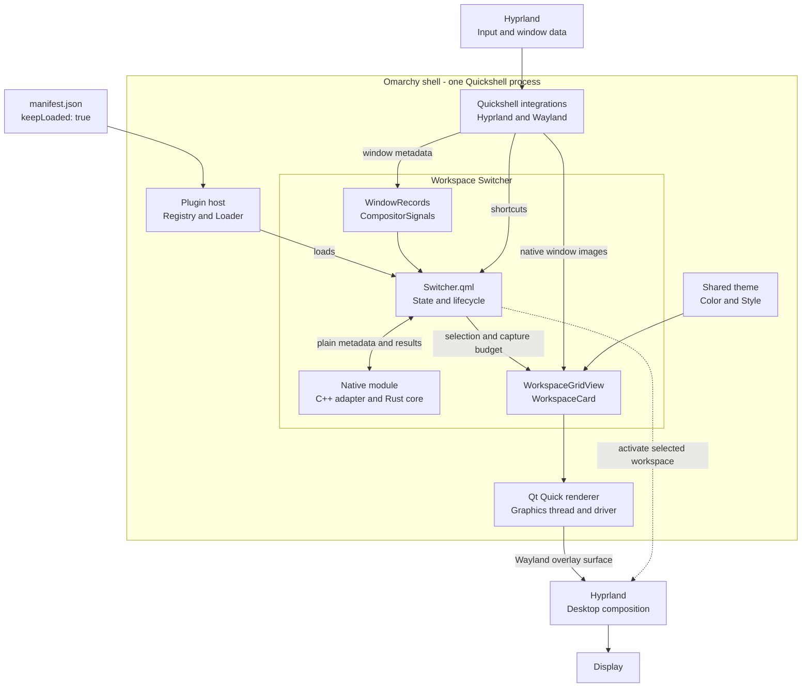
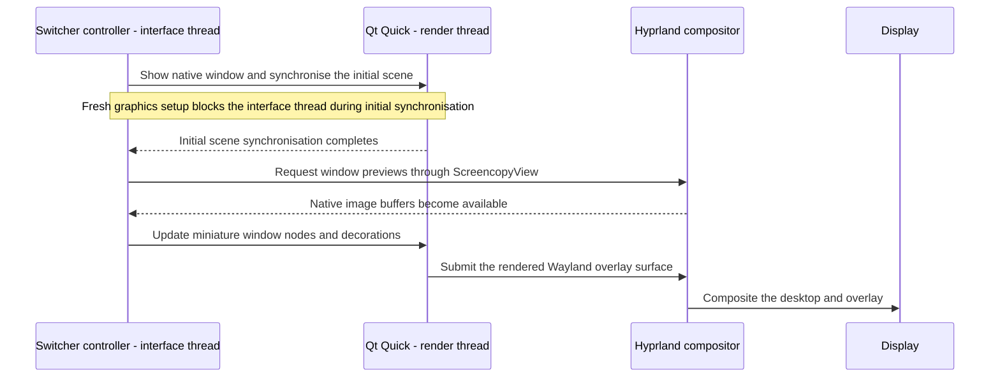

# Architecture

Workspace Switcher runs inside Omarchy's existing Quickshell process. The bar,
menus, notifications and lock screen share that process. Our plugin has its own
overlay and state, but does not start a second desktop shell or background service.

The interface uses Qt Modeling Language (QML) with small JavaScript handlers.
Rust calculates workspace ordering, navigation and preview geometry. Quickshell's
native components capture window images, and Qt Quick draws the result.

## Where the plugin fits

Hyprland is shown at both ends for clarity. It is the same compositor process,
providing the windows we preview and composing the finished overlay onto the desktop.
The Rust module, interface and renderer all remain in the same Quickshell process.
The compiled module is a library, not a separate application.

Omarchy reads `manifest.json` and loads `Switcher.qml`. `keepLoaded` keeps the
controller mounted between uses, so its recent-workspace history survives when
the overlay closes. The native display window is a separate object and is
created when the overlay opens.

The default Hyprland bindings send native global shortcuts to the loaded
controller. They do not start a shell command on each Tab press. Tab presses
inside the overlay also reach its key surface. Modifier trackers cover a release
that happens before the overlay receives focus.

## How previews are rendered

A workspace preview is assembled from individual window images. It is not a
saved screenshot of the whole workspace. `WindowRecords.qml` joins Quickshell's
window handles with Hyprland's workspace, monitor and rectangle data. Monitor
scaling and rotation are accounted for before Rust normalises the rectangles.

Rust receives plain metadata encoded as JavaScript Object Notation (JSON).
It returns ordering, group information, indices and normalised coordinates.
Navigation also has a direct integer method. No window handles or image buffers
cross into Rust. The existing interface retains those handles and their lifetimes.

`WorkspaceCard.qml` places a native `ScreencopyView` at each window's position in
the miniature workspace. The preview canvas clips content outside the monitor,
so floating and scrolling layouts keep their reported geometry. Qt Quick draws
those images over the current wallpaper, together with the card border,
workspace number and selected dot. The wallpaper is loaded from Omarchy's
existing file and warmed in memory before opening; Rust never receives it.

The following sequence describes the tested default threaded OpenGL renderer.
Other Qt rendering modes can use a different threading arrangement.

The layer window covers the focused monitor with a theme-coloured backdrop.
The preview row is centred over it and reserves no desktop space. The backdrop
can be translucent or opaque; the focused key surface handles Super+Backspace
to change it without targeting a regular desktop window.
Keyboard focus and a shortcut inhibitor belong to the overlay while it is open.
The inhibitor prevents desktop gestures from acting on windows behind it.

Capture work is limited to visible cards, with the selected workspace scheduled
first. The first batch starts when geometry is ready, and later batches are
paced. There are at most 20 enabled capture sources. `live: false` requests
snapshots rather than a continuous background stream.

On modifier release, the controller disconnects capture sources, unmaps the
overlay and activates a representative native window from the selected workspace.
Hyprland then shows that workspace. The controller remains loaded, while window
records and capture delegates used by the open overlay are cleared.

## Module guide

| Module | Responsibility |
|---|---|
| [`manifest.json`](../manifest.json) | Plugin identity, entry point and persistent controller loading. |
| [`Switcher.qml`](../Switcher.qml) | Session history state, selected workspace, opening and closing, native shortcuts, layer window and capture scheduling. |
| [`CompositorSignals.qml`](../components/CompositorSignals.qml) | Window, workspace and monitor notifications, including the geometry-reply notification. |
| [`WindowRecords.qml`](../components/WindowRecords.qml) | Associates native window handles with metadata and stable source tokens. |
| [`SwitcherKeySurface.qml`](../components/SwitcherKeySurface.qml) | Cycling, modifier release and the opacity shortcut inside the overlay. |
| [`WorkspaceGridView.qml`](../components/WorkspaceGridView.qml) | Horizontal layout, scrolling, selection visibility and capture priority. |
| [`WorkspaceCard.qml`](../components/WorkspaceCard.qml) | Composes wallpaper and native window images at Rust-calculated positions, with a workspace number and selection marker. |
| [`WorkspacePresentation.qml`](../components/WorkspacePresentation.qml) and [`compact.json`](../compact.json) | Bounded appearance settings, display proportions, wallpaper preloading and file watching. |
| [`WorkspaceCore.qml`](../native/WorkspaceCore.qml) and [`coreplugin.cpp`](../native/coreplugin.cpp) | Expose the compiled core as a Qt object. CXX generates the bridge between C++ and Rust. |
| [`lib.rs`](../rust/src/lib.rs) | Parses and bounds metadata, routes operations and reports invalid input. |
| [`core.rs`](../rust/src/core.rs) | Stateless history, ordering, navigation, grouping, geometry and preview-change calculations. |

`Quickshell.Hyprland` supplies compositor data and global shortcuts.
`Quickshell.Wayland` supplies window handles, capture components and layer-window
integration. `Quickshell.Io` supplies input/output helpers such as file watching.
Omarchy's `qs.Commons` supplies colours, typography, spacing and theme roles.
The core does not maintain a second copy of the controller's history.

## Loading and opening cost

Cargo builds the Rust code into a static library. `qmake6` and the C++ compiler
link it into `native/libworkspace_switcher_native.so`. The build also generates
the module's local library path. Quickshell loads this library into its existing
process when the interface imports `WorkspaceCore`.

Closing the overlay destroys its native layer window in the tested Quickshell
build. The next opening therefore starts a new render thread and initialises
its graphics context again. That native setup accounts for most of the measured
opening delay. Keeping the controller and Rust library loaded does not keep this
window's renderer alive. The [design and timing notes](design.md) document the
measurements, update process and rollback instructions.
